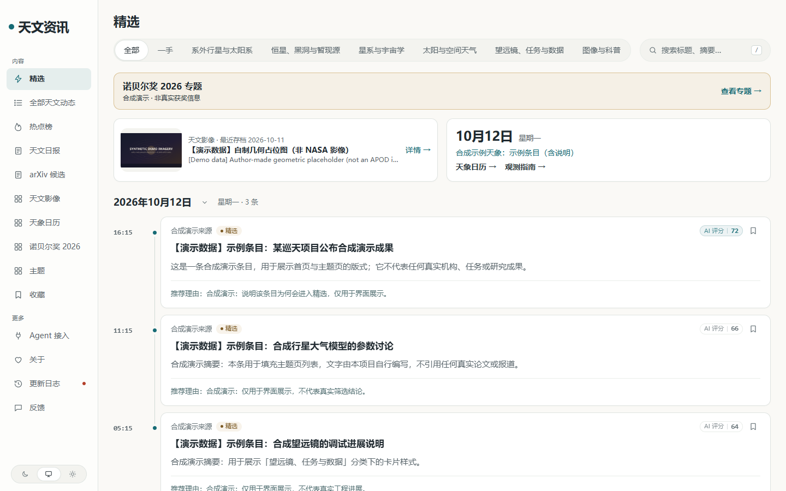
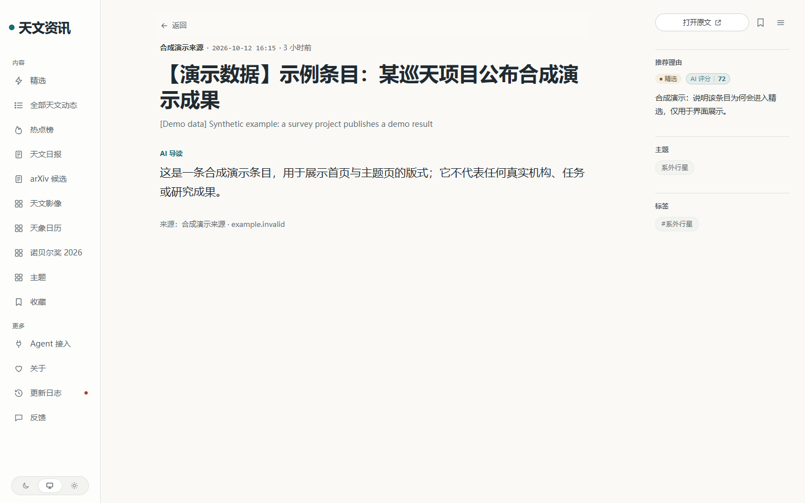
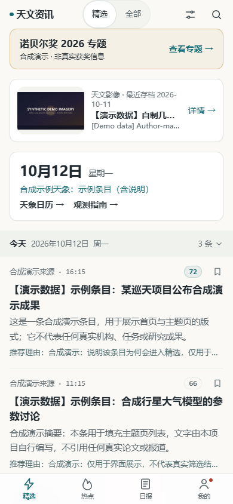
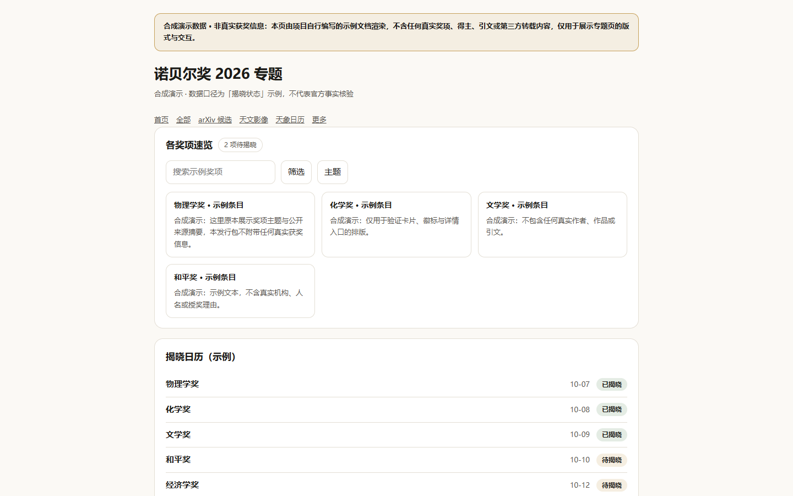

# AstroHot

[中文](README.md) | [English](README.en.md)

> **Experimental lightweight astronomy information aggregation; not a production upgrade.** This branch combines PRs #8 and #9 with a scheduler-test fix. It still has unresolved paid-recovery and manual-extraction issues. See the [workflow comparison and limitations](docs/EXPERIMENTAL-EDITORIAL-AGGREGATION.md).

## Choosing a branch

- [`main`](https://github.com/sw2sw/AstroHot/tree/main): the default comprehensive astronomy platform and candidate for production releases. Deploy a fixed revision validated in your own environment.
- [`experiment/editorial-cost-reduction`](https://github.com/sw2sw/AstroHot/tree/experiment/editorial-cost-reduction): the alternative lightweight information-aggregation workflow; not currently recommended for production.

These are different editorial workflows in the same framework, not separate finished products. A branch name is not proof of deployment or acceptance.

**Astronomy news, initial paper screening, and bilingual reading.**

AstroHot collects astronomy news and paper metadata, retains sources and original links, and uses configurable models for screening, summaries, and translation. Reading is available through a Web UI and API. Deploy your own instance or contribute to astronomy features, the frontend, backend, or documentation.

> The project is still evolving: type checking and some backend tests have known gaps. Before deploying, read the [deployment guide](docs/DEPLOYMENT.en.md), [known issues](KNOWN-ISSUES.en.md), and [validation scope](docs/VALIDATION.en.md). AI screening is not full-text reading, peer review, or scientific fact verification.

## Agent Skill: public astronomy information queries

The experimental route links to the published [`astronomy-sources` Skill](https://ucas.sitianai.com/static/skills/astronomy-sources/SKILL.md). Agents can query public news and selected items by keyword, category, source, original publication date, or collection date, with source introductions and original links. See the Skill for source/date filtering; the public API covers the last seven days.

Public reads require no login or API key and do not trigger collection or model generation. This is a content-query interface, not an inference API. Introductions may be absent and titles may retain their original language. Keep original publication, collection, and screening times distinct.

[Query reference](https://ucas.sitianai.com/static/skills/astronomy-sources/llms.txt) · [Public API example](https://ucas.sitianai.com/astrohot/api/v1/items?mode=all&window=7d&limit=5).

These links refer to a separately published online service. Cloning this repository does not deploy that service, include its operational content, or install the Skill. Self-hosted deployments should use their own public address. Review external Skill instructions before use and verify important claims against the original sources.

## Features

- **News and selected items**: configurable sources, screening, event grouping, and deduplication, with original links, dates, and attribution.
- **Paper reading**: arXiv metadata collection, model-assisted initial screening, and bilingual reading. Collection, analysis, and display have separate controls.
- **Daily, weekly, and monthly reports**: daily issues are arranged by rules; weekly and monthly issues compile daily reports. Issues without eligible entries are skipped rather than published empty.
- **Web and API**: desktop and mobile reading, topic and event navigation. Reading pages do not invoke models.
- **Imagery and topics**: imagery archives, a sky calendar, and a Nobel Prize topic. The software does not include the operational content collection; missing authorized data produces empty states or explicitly labelled synthetic demonstrations.
- **Administration**: source and model settings, error records, and receipts. See [known issues](KNOWN-ISSUES.en.md) for model capacity, uncertain results, and recovery boundaries.

## Interface previews

These screenshots use author-written synthetic demonstrations, not real news, paper analyses, or award information.

| Home (desktop) | Entry detail (desktop) |
| --- | --- |
|  |  |

| Home (mobile) | Nobel Prize topic (synthetic demo) |
| --- | --- |
|  |  |

## Getting started

Requirements: Node.js **>=24.11**, npm workspaces, and PostgreSQL. The reference Compose configuration uses PostgreSQL 17.

```sh
git clone https://github.com/sw2sw/AstroHot.git
cd AstroHot
cp .env.example .env
```

Follow the [deployment guide](docs/DEPLOYMENT.en.md) to configure a separate database, strong passwords, and signing secrets, then choose native or Docker/Compose startup. Do not start with an unconfigured `.env`. Independent Docker acceptance limitations remain documented in the [validation scope](docs/VALIDATION.en.md).

**Keep collection, model calls, arXiv analysis/reports, imagery tasks, and push disabled for initial startup.** Verify installation, login, pages, and persistence first. Enable features individually after checking source permissions, model providers, budgets, and capacity. No runtime credentials are supplied; do not use a production database or real paid calls to verify initial startup.

## Documentation

- Deployment and administration: [deployment, upgrades, and backups](docs/DEPLOYMENT.en.md) · [administration](docs/ADMIN.en.md) · [error recording](docs/ERROR-RECORDING.en.md)
- Sources and screening: [source configuration](docs/SOURCES.en.md) · [collection and analysis cadence](docs/CADENCE.en.md) · [scoring](docs/SCORING.en.md)
- Observing: [guide configuration and use](docs/OBSERVING-GUIDES.en.md)
- Content and demos: [Nobel Prize topic](docs/NOBEL.en.md) · [synthetic demo data](database/demo/README.en.md) · [content-rights review](docs/CONTENT-RIGHTS.en.md)
- Project status: [known issues](KNOWN-ISSUES.en.md) · [development TODO](docs/TODO.en.md) · [validation scope](docs/VALIDATION.en.md)

## Contributing

Reproducible bug reports, documentation corrections, source-permission evidence, and narrow improvements are welcome. Read the [contribution guide](CONTRIBUTING.en.md) first. Use synthetic or redacted examples; do not attach real user data, secrets, private addresses, or operational databases. Follow [security reporting](SECURITY.en.md) for vulnerabilities rather than publishing exploit details.

## Licensing and content boundaries

Software source and applicable documentation retain the existing **MIT** [LICENSE](LICENSE) and [NOTICE](NOTICE). Bundled third-party assets, including fonts, follow their own licences. See the [licensing guide](docs/LICENSING.en.md), [copyright and usage statement](docs/COPYRIGHT.en.md), and [disclaimer](docs/DISCLAIMER.en.md).

**The software distribution excludes the operational content collection and grants no copyright in third-party news, papers, images, or other materials.** Attribution, original links, accessible RSS, or AI rewriting do not automatically authorize reuse. Independent deployers must assess collection, storage, model processing, and public display separately. A disclaimer is not a guarantee of immunity from liability.

## Upstream

Adapted from [AIHOT](https://github.com/KKKKhazix/AIHOT), retaining `Copyright (c) 2026 数字生命卡兹克` and the original MIT LICENSE/NOTICE. The AIHOT name and logo are not granted under the code's MIT licence. AstroHot does not inherit upstream maintenance commitments.
