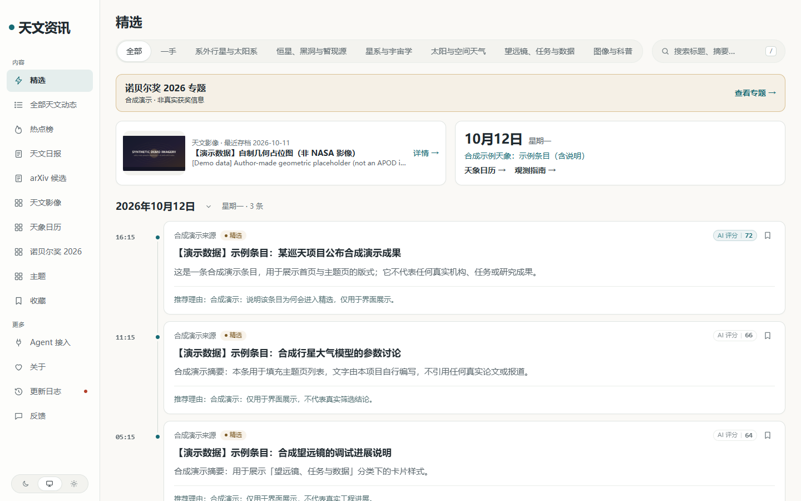
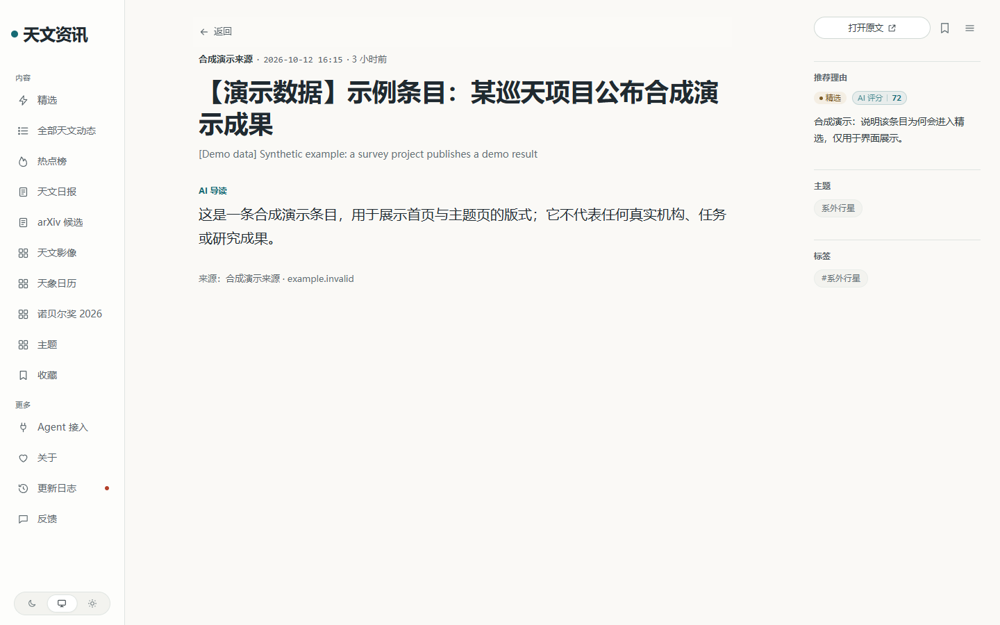
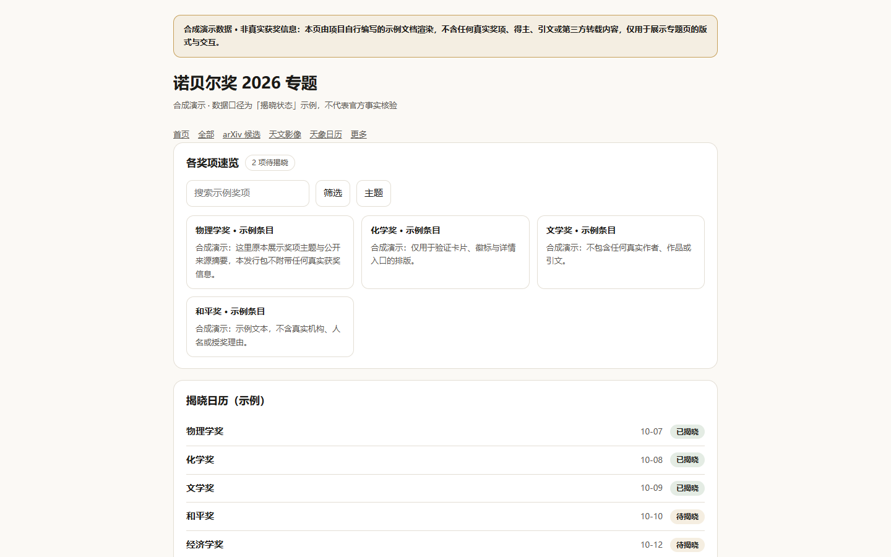

# AstroHot

[中文](README.md) | [English](README.en.md)

**天文资讯、论文初筛与双语阅读平台。**

AstroHot 汇集天文新闻与论文元数据，保留来源和原文入口，使用可配置模型辅助筛选、摘要与翻译，通过 Web 和 API 提供阅读。适合自行部署，也欢迎天文、前端、后端和文档方向的贡献者参与。

> 项目仍在完善：类型检查和部分后端测试有已知缺口。开始使用前请查看[部署指南](docs/DEPLOYMENT.md)、[已知问题](KNOWN-ISSUES.md)及[验证范围](docs/VALIDATION.md)。AI 初筛不等于阅读全文、同行评议或科学事实核验。

## 功能

- **资讯与精选**：可配置来源、筛选、事件归组和去重，保留原始链接、日期与署名。
- **论文阅读**：arXiv 元数据采集、模型辅助初筛和双语阅读；采集、分析与展示分别控制。
- **日报、周报、月报**：日报按规则编排，周报和月报汇编日报；无合格条目的刊期正常跳过，不强行生成空报表。
- **Web 与 API**：桌面和手机阅读、主题与事件入口。阅读页面不触发模型调用。
- **影像与专题**：影像归档、天象日历及诺贝尔奖专题等功能入口；软件包不附运营内容库，缺少授权数据时显示空态或明确标注的合成演示。
- **后台管理**：来源与模型设置、错误记录和回执等运维入口；模型容量、未知结果与恢复边界见[已知问题](KNOWN-ISSUES.md)。

## 界面预览

以下截图使用自编合成演示，不是真实新闻、论文分析或获奖信息。

| 首页（桌面） | 条目详情（桌面） |
| --- | --- |
|  |  |

| 首页（手机） | 诺贝尔奖专题（合成演示） |
| --- | --- |
|  |  |

## 开始使用

环境要求：Node.js **>=24.11**、npm workspaces 和 PostgreSQL；参考 Compose 配置使用 PostgreSQL 17。

```sh
git clone https://github.com/sw2sw/AstroHot.git
cd AstroHot
cp .env.example .env
```

接着按[部署指南](docs/DEPLOYMENT.md)设置独立数据库、强密码与签名密钥，再选择原生或 Docker/Compose 启动方式。不要直接使用未配置的 `.env` 启动；独立 Docker 复验的限制仍见[验证范围](docs/VALIDATION.md)。

**初次启动保持采集、模型调用、arXiv 分析/日报、影像任务与推送关闭。**先确认安装、登录、页面和数据持久化，再按来源权限、模型供应商、预算与容量逐项启用。仓库不提供运行凭据，不使用生产库或真实付费调用验证初次启动。

## 文档导航

- 部署与管理：[部署、升级和备份](docs/DEPLOYMENT.md) · [后台设置](docs/ADMIN.md) · [错误记录](docs/ERROR-RECORDING.md)
- 来源与筛选：[来源配置](docs/SOURCES.md) · [采集与分析频度](docs/CADENCE.md) · [评分方法](docs/SCORING.md)
- 观测实用：[观测指南设置与使用](docs/OBSERVING-GUIDES.md)
- 内容与演示：[诺贝尔奖专题](docs/NOBEL.md) · [合成演示数据](database/demo/README.md) · [内容版权核查](docs/CONTENT-RIGHTS.md)
- 项目状态：[已知问题](KNOWN-ISSUES.md) · [开发 TODO](docs/TODO.md) · [验证范围](docs/VALIDATION.md)

## 参与贡献

欢迎提交可复现的 Bug、文档纠错、来源权限证据和小范围改进。提交前请阅读[贡献指南](CONTRIBUTING.md)；使用合成或脱敏案例，不附真实用户数据、密钥、私有地址或运营数据库。安全问题请按[安全报告说明](SECURITY.md)处理，不公开利用细节。

## 许可与内容边界

软件源码及适用文档沿用现有 **MIT** [LICENSE](LICENSE) 和 [NOTICE](NOTICE)；附带字体等第三方资产遵循各自许可。详见[许可说明](docs/LICENSING.md)、[版权与使用声明](docs/COPYRIGHT.md)和[免责声明](docs/DISCLAIMER.md)。

**软件分发不携带运营内容库，也不授予第三方新闻、论文、图片或其他材料的版权。**署名、原文链接、RSS 可访问或 AI 改写不自动代表再利用许可；独立部署者须核查采集、存储、模型处理及公开展示各环节的权限。免责声明不是免责保证。

## 上游

基于 [AIHOT](https://github.com/KKKKhazix/AIHOT) 改造，保留 `Copyright (c) 2026 数字生命卡兹克` 及原 MIT LICENSE/NOTICE。AIHOT 名称与 Logo 不随代码 MIT 授权；AstroHot 不继承上游的维护承诺。
